# [📈 Live Status](https://gonsett.github.io/estado): <!--live status--> **🟩 All systems operational**

This repository contains the open-source uptime monitor and status page for [gonsett](https://gonsett.github.io/estado), powered by [Upptime](https://github.com/upptime/upptime).

With [Upptime](https://upptime.js.org), you can get your own unlimited and free uptime monitor and status page, powered entirely by a GitHub repository. We use [Issues](https://github.com/gonsett/estado/issues) as incident reports, [Actions](https://github.com/gonsett/estado/actions) as uptime monitors, and [Pages](https://gonsett.github.io/estado) for the status page.

<!--start: status pages-->
<!-- This summary is generated by Upptime (https://github.com/upptime/upptime) -->
<!-- Do not edit this manually, your changes will be overwritten -->
<!-- prettier-ignore -->
| URL | Status | History | Response Time | Uptime |
| --- | ------ | ------- | ------------- | ------ |
|  [Quantum Coffee](https://quantumcoffee.xyz) | 🟩 Up | [quantum-coffee.yml](https://github.com/gonsett/estado/commits/HEAD/history/quantum-coffee.yml) | 

 990ms
     
 | 

<a href="https://gonsett.github.io/estado/history/quantum-coffee">100.00%</a>
    

|  [Canova](https://canova.quantumcoffee.xyz) | 🟩 Up | [canova.yml](https://github.com/gonsett/estado/commits/HEAD/history/canova.yml) | 

 329ms
     
 | 

<a href="https://gonsett.github.io/estado/history/canova">100.00%</a>
    

|  [Canova · app](https://app.canova.quantumcoffee.xyz) | 🟩 Up | [canova-app.yml](https://github.com/gonsett/estado/commits/HEAD/history/canova-app.yml) | 

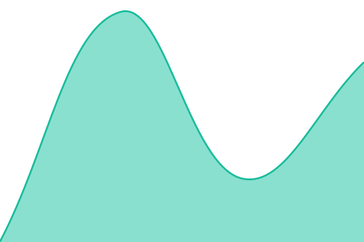 571ms
     
 | 

<a href="https://gonsett.github.io/estado/history/canova-app">100.00%</a>
    

|  [Caudal](https://caudal.quantumcoffee.xyz) | 🟩 Up | [caudal.yml](https://github.com/gonsett/estado/commits/HEAD/history/caudal.yml) | 

 383ms
     
 | 

<a href="https://gonsett.github.io/estado/history/caudal">100.00%</a>
    

|  [Caudal · app](https://app.caudal.quantumcoffee.xyz) | 🟩 Up | [caudal-app.yml](https://github.com/gonsett/estado/commits/HEAD/history/caudal-app.yml) | 

 466ms
     
 | 

<a href="https://gonsett.github.io/estado/history/caudal-app">100.00%</a>
    

|  [Zenit](https://zenit.quantumcoffee.xyz) | 🟩 Up | [zenit.yml](https://github.com/gonsett/estado/commits/HEAD/history/zenit.yml) | 

 445ms
     
 | 

<a href="https://gonsett.github.io/estado/history/zenit">100.00%</a>
    

|  [Zenit · app](https://app.zenit.quantumcoffee.xyz) | 🟩 Up | [zenit-app.yml](https://github.com/gonsett/estado/commits/HEAD/history/zenit-app.yml) | 

 1355ms
     
 | 

<a href="https://gonsett.github.io/estado/history/zenit-app">100.00%</a>
    

|  [Taival](https://taival.quantumcoffee.xyz) | 🟩 Up | [taival.yml](https://github.com/gonsett/estado/commits/HEAD/history/taival.yml) | 

 499ms
     
 | 

<a href="https://gonsett.github.io/estado/history/taival">100.00%</a>
    

|  [Taival · app](https://app.taival.quantumcoffee.xyz) | 🟩 Up | [taival-app.yml](https://github.com/gonsett/estado/commits/HEAD/history/taival-app.yml) | 

 214ms
     
 | 

<a href="https://gonsett.github.io/estado/history/taival-app">100.00%</a>
    

|  [Tupé](https://tupe.quantumcoffee.xyz) | 🟩 Up | [tupe.yml](https://github.com/gonsett/estado/commits/HEAD/history/tupe.yml) | 

 347ms
     
 | 

<a href="https://gonsett.github.io/estado/history/tupe">100.00%</a>
    

|  [Tupé · app](https://app.tupe.quantumcoffee.xyz) | 🟩 Up | [tupe-app.yml](https://github.com/gonsett/estado/commits/HEAD/history/tupe-app.yml) | 

 286ms
     
 | 

<a href="https://gonsett.github.io/estado/history/tupe-app">100.00%</a>
    

|  [Ring Closers](https://ringclosers.quantumcoffee.xyz) | 🟩 Up | [ring-closers.yml](https://github.com/gonsett/estado/commits/HEAD/history/ring-closers.yml) | 

 585ms
     
 | 

<a href="https://gonsett.github.io/estado/history/ring-closers">100.00%</a>
    

|  [Nocturna](https://nocturna.quantumcoffee.xyz) | 🟩 Up | [nocturna.yml](https://github.com/gonsett/estado/commits/HEAD/history/nocturna.yml) | 

 352ms
     
 | 

<a href="https://gonsett.github.io/estado/history/nocturna">100.00%</a>
    

|  [YAXmedia · Alberto Berdini](https://yaxmedia-alberto-berdini.vercel.app) | 🟩 Up | [ya-xmedia-alberto-berdini.yml](https://github.com/gonsett/estado/commits/HEAD/history/ya-xmedia-alberto-berdini.yml) | 

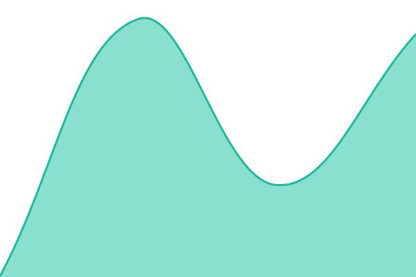 326ms
     
 | 

<a href="https://gonsett.github.io/estado/history/ya-xmedia-alberto-berdini">100.00%</a>
    

|  [YAXmedia · Ángel Di Naro](https://yaxmedia-angel-di-naro.vercel.app) | 🟩 Up | [ya-xmedia-angel-di-naro.yml](https://github.com/gonsett/estado/commits/HEAD/history/ya-xmedia-angel-di-naro.yml) | 

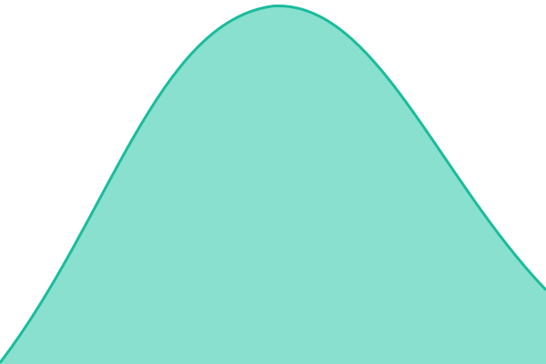 295ms
     
 | 

<a href="https://gonsett.github.io/estado/history/ya-xmedia-angel-di-naro">100.00%</a>
    

|  [YAXmedia · AB Collection](https://yaxmedia-ab-collection.vercel.app) | 🟩 Up | [ya-xmedia-ab-collection.yml](https://github.com/gonsett/estado/commits/HEAD/history/ya-xmedia-ab-collection.yml) | 

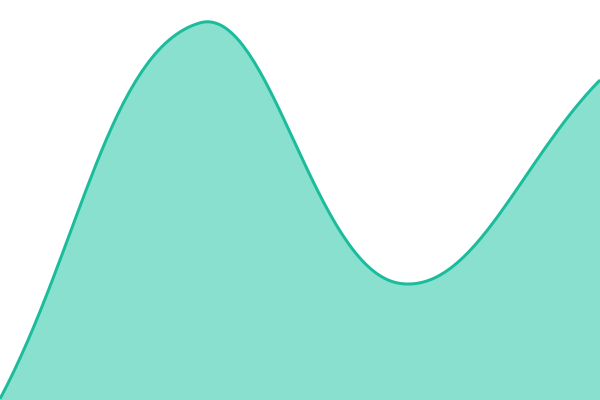 330ms
     
 | 

<a href="https://gonsett.github.io/estado/history/ya-xmedia-ab-collection">100.00%</a>
    

|  [YAXmedia · Daniel Lerner](https://yaxmedia-plan-daniel-lerner.vercel.app) | 🟩 Up | [ya-xmedia-daniel-lerner.yml](https://github.com/gonsett/estado/commits/HEAD/history/ya-xmedia-daniel-lerner.yml) | 

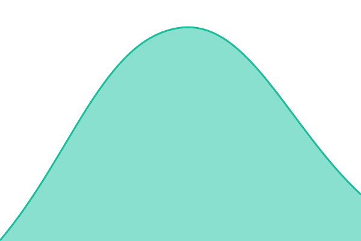 354ms
     
 | 

<a href="https://gonsett.github.io/estado/history/ya-xmedia-daniel-lerner">100.00%</a>
    

|  [YAXmedia · Marcos Argenti](https://yaxmedia-marcos-argenti.vercel.app) | 🟩 Up | [ya-xmedia-marcos-argenti.yml](https://github.com/gonsett/estado/commits/HEAD/history/ya-xmedia-marcos-argenti.yml) | 

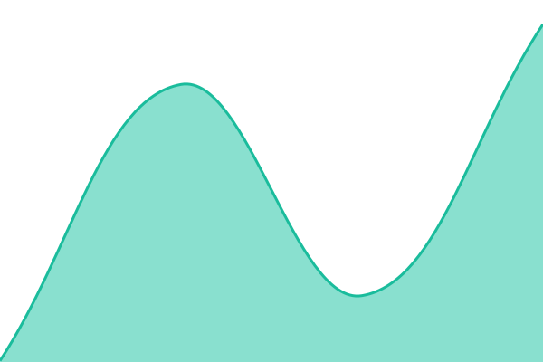 230ms
     
 | 

<a href="https://gonsett.github.io/estado/history/ya-xmedia-marcos-argenti">100.00%</a>
    

|  [YAXmedia · Servicios completa](https://yaxmedia-servicios-completa.vercel.app) | 🟩 Up | [ya-xmedia-servicios-completa.yml](https://github.com/gonsett/estado/commits/HEAD/history/ya-xmedia-servicios-completa.yml) | 

 250ms
     
 | 

<a href="https://gonsett.github.io/estado/history/ya-xmedia-servicios-completa">100.00%</a>
    

|  [YAXmedia · Servicios](https://yaxmedia-servicios.vercel.app) | 🟩 Up | [ya-xmedia-servicios.yml](https://github.com/gonsett/estado/commits/HEAD/history/ya-xmedia-servicios.yml) | 

 329ms
     
 | 

<a href="https://gonsett.github.io/estado/history/ya-xmedia-servicios">100.00%</a>
    

|  [YAXmedia · Presentación](https://yaxmedia-presentacion.vercel.app) | 🟩 Up | [ya-xmedia-presentacion.yml](https://github.com/gonsett/estado/commits/HEAD/history/ya-xmedia-presentacion.yml) | 

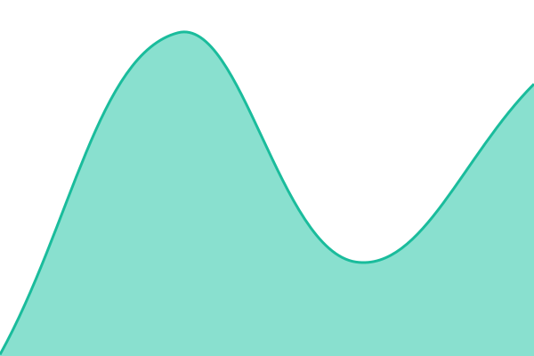 227ms
     
 | 

<a href="https://gonsett.github.io/estado/history/ya-xmedia-presentacion">100.00%</a>
    

|  [YAXmedia · Propuesta](https://yaxmedia-propuesta.vercel.app) | 🟩 Up | [ya-xmedia-propuesta.yml](https://github.com/gonsett/estado/commits/HEAD/history/ya-xmedia-propuesta.yml) | 

 202ms
     
 | 

<a href="https://gonsett.github.io/estado/history/ya-xmedia-propuesta">100.00%</a>
    

|  [YAXmedia · José](https://yaxmedia-jose.vercel.app) | 🟩 Up | [ya-xmedia-jose.yml](https://github.com/gonsett/estado/commits/HEAD/history/ya-xmedia-jose.yml) | 

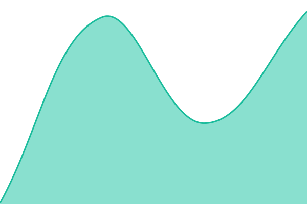 229ms
     
 | 

<a href="https://gonsett.github.io/estado/history/ya-xmedia-jose">100.00%</a>
    

|  [YAXmedia · Diego Donalisis](https://yaxmedia-diego-donalisis.vercel.app) | 🟩 Up | [ya-xmedia-diego-donalisis.yml](https://github.com/gonsett/estado/commits/HEAD/history/ya-xmedia-diego-donalisis.yml) | 

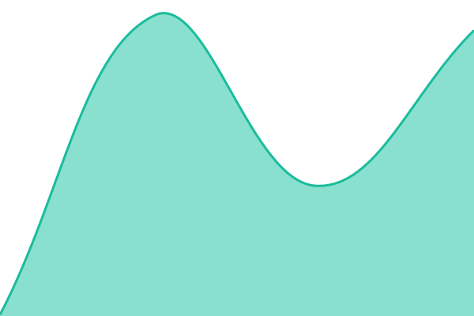 239ms
     
 | 

<a href="https://gonsett.github.io/estado/history/ya-xmedia-diego-donalisis">100.00%</a>
    

|  [YAXmedia · Fran Piñeiro Negri](https://yaxmedia-fran-pineiro-negri.vercel.app) | 🟩 Up | [ya-xmedia-fran-pineiro-negri.yml](https://github.com/gonsett/estado/commits/HEAD/history/ya-xmedia-fran-pineiro-negri.yml) | 

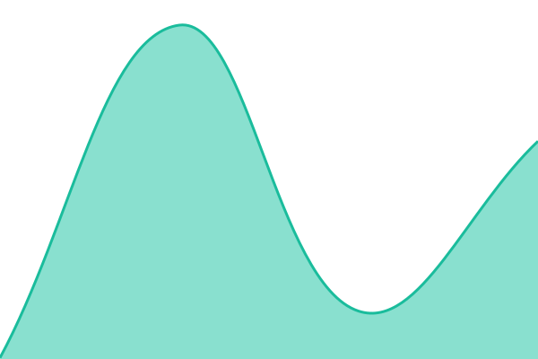 279ms
     
 | 

<a href="https://gonsett.github.io/estado/history/ya-xmedia-fran-pineiro-negri">100.00%</a>
    

|  [YAXmedia · Jorge Sánchez](https://yaxmedia-jorge-sanchez.vercel.app) | 🟩 Up | [ya-xmedia-jorge-sanchez.yml](https://github.com/gonsett/estado/commits/HEAD/history/ya-xmedia-jorge-sanchez.yml) | 

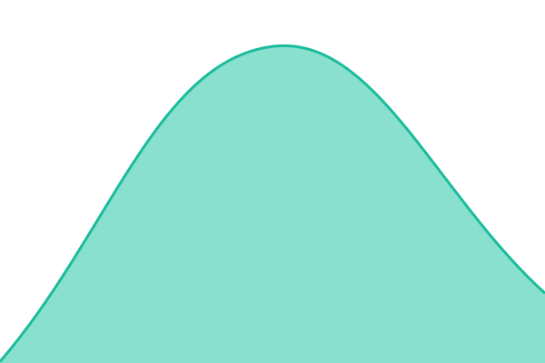 218ms
     
 | 

<a href="https://gonsett.github.io/estado/history/ya-xmedia-jorge-sanchez">100.00%</a>
    

<!--end: status pages-->

[**Visit our status website →**](https://gonsett.github.io/estado)

## 📄 License

- Powered by: [Upptime](https://github.com/upptime/upptime)
- Code: [MIT](./LICENSE) © [Anand Chowdhary](https://anandchowdhary.com)
- Data in the `./history` directory: [Open Database License](https://opendatacommons.org/licenses/odbl/1-0/)
